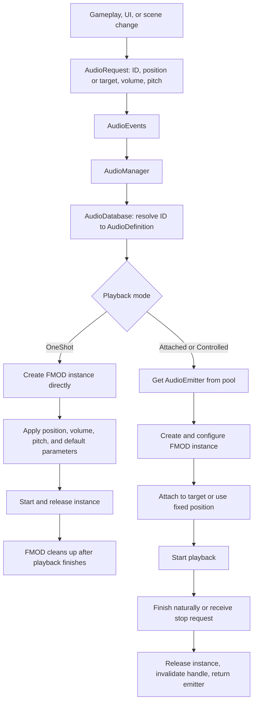

# Audio System

A Unity audio system built on FMOD, with ID-based sound lookup, an event-based playback API, and pooled emitters for attached and controlled sounds.

> Gameplay owns the trigger, the database owns the mapping and defaults, the audio manager owns routing, emitters own managed playback lifetimes, and FMOD owns the sound design.

## Contents

- [Versions and prerequisites](#versions-and-prerequisites)
- [Workflow overview](#workflow-overview)
- [Core components](#core-components)
- [Startup and scene setup](#startup-and-scene-setup)
- [From a footstep to a sound](#from-a-footstep-to-a-sound)
- [Choosing a playback mode](#choosing-a-playback-mode)
- [Playback lifetime and pooling](#playback-lifetime-and-pooling)
- [Music and runtime parameters](#music-and-runtime-parameters)
- [Adding a new sound](#adding-a-new-sound)
- [Validation and troubleshooting](#validation-and-troubleshooting)
- [Suggested developer demo](#suggested-developer-demo)

## Versions and prerequisites

The source project uses the following versions:

| Component | Version |
|---|---|
| Unity Editor | **6000.5.11f1** (Unity 6.5) |
| FMOD Unity integration API | **2.03.15** |

The Unity version is recorded in [ProjectVersion.txt](ProjectSettings/ProjectVersion.txt). The FMOD version comes from `FMOD.VERSION.number` in the bundled [FMOD API](Assets/Plugins/FMOD/src/fmod.cs).

These are the source project's versions, not a verified minimum compatibility range. Compatibility with other versions and clean-project package imports must be validated separately.

- Install and configure the FMOD Unity integration separately when importing the standalone audio package.
- Provide FMOD events and built banks compatible with the installed FMOD runtime.
- Unity UI (uGUI) is required when using `UIAudioFeedback`.
- The FMOD Studio authoring application version is not established by the integration API version above.

## Workflow overview

Gameplay decides **when** a sound should happen. The audio system resolves **which** FMOD event to use, configures it, and manages its lifetime. FMOD handles the authored sound behavior.



**Not every sound uses the pool.** One-shots take a direct path; attached and controlled sounds use pooled emitters.

The event API dispatches requests synchronously to the enabled manager. It is not a persistent request queue.

## Core components

| Component | Responsibility |
|---|---|
| [AudioID](Assets/_Project/AudioSystem/Data/AudioID.cs) | Stable identifiers such as footsteps, wind, music, and UI clicks. |
| [AudioDatabase](Assets/_Project/AudioSystem/Data/AudioDatabase.cs) | ScriptableObject that maps IDs to definitions and validates configuration. |
| [AudioDefinition](Assets/_Project/AudioSystem/Data/AudioDefinition.cs) | FMOD event reference, default volume, and initial parameter values. |
| [AudioRequest](Assets/_Project/AudioSystem/RunTime/AudioRequest.cs) | Data for a particular playback: ID, mode, position or target, volume, and pitch. |
| [AudioEvents](Assets/_Project/AudioSystem/RunTime/AudioEvents.cs) | Public interface for playing, stopping, and updating sounds. Also defines `AudioPlaybackHandle`. |
| [AudioManager](Assets/_Project/AudioSystem/RunTime/AudioManager.cs) | Persistent singleton that resolves requests and selects the playback path. |
| [AudioEmitter](Assets/_Project/AudioSystem/RunTime/AudioEmitter.cs) | Owns an FMOD instance for attached or controlled playback and handles cleanup. |
| [AudioEmitterPool](Assets/_Project/AudioSystem/RunTime/AudioEmitterPool.cs) | Creates and reuses emitter GameObjects. |
| [UIAudioFeedback](Assets/_Project/AudioSystem/RunTime/UIAudioFeedback.cs) | Connects interactable Unity buttons to click, hover, and navigation-selection sounds. |

Callers generally reference sound IDs rather than FMOD event paths. An event can be remapped in the database without changing gameplay code.

## Startup and scene setup

1. Ensure FMOD's Unity integration is configured and the required event banks are built and available.
2. Place an enabled audio manager on a root GameObject in the starting scene.
3. Assign the [audio database asset](Assets/_Project/AudioSystem/Data/AudioDatabase.asset) and [emitter prefab](Assets/_Project/AudioSystem/Prefabs/AudioEmitter.prefab).
4. Optionally assign an active emitter container. Otherwise, the manager uses its own Transform.
5. Ensure the FMOD listener is configured for the intended spatial playback.

During `Awake`, the manager:

- Rejects duplicate manager instances.
- Persists across scene changes with `DontDestroyOnLoad`.
- Gets or adds an emitter pool.
- Initializes the pool and prewarms emitters.

During `OnEnable`, it subscribes to play, controlled-play, stop, and parameter-update events.

Prewarming defaults to **8 emitters**. Set it to `0` to disable prewarming. This value is not a concurrency limit: the pool grows when all available emitters are in use.

## From a footstep to a sound

The existing [gameplay integration](Assets/_Project/Scripts/GameManager.cs) connects player movement events to audio:

1. The player controller raises a footstep event.
2. The gameplay manager checks that gameplay has not ended.
3. It sends a one-shot request at the player's current position:

```csharp
AudioEvents.Play(
    new AudioRequest(AudioID.PlayerFootsteps, player.transform.position));
```

4. The audio manager receives the request and looks up its definition.
5. The database resolves the ID to `event:/SFX/footstep`.
6. The system creates an FMOD instance and applies:
   - The requested position.
   - Volume: **definition default volume multiplied by request volume**.
   - Request pitch.
   - Configured default parameters.
7. It starts and releases the instance.

Release does **not** immediately stop a successfully started one-shot. It allows FMOD to clean up after playback finishes.

The position is a snapshot: this sound does not keep following the player. Whether position affects the audible result depends on the event's FMOD spatial authoring.

## Choosing a playback mode

| Mode | Typical use | Behavior |
|---|---|---|
| `OneShot` | Footsteps, pickups, UI clicks | Direct FMOD instance; fire-and-forget, with no playback handle. Use finite events. |
| `Attached` | Sound that moves with an object | Pooled emitter; follows a Transform through FMOD's Unity integration. |
| `Controlled` | Wind, music, or another sound needing explicit control | Pooled emitter at a fixed position; the controlled API returns a playback handle. |

### One-shot

```csharp
// Positional effect.
AudioEvents.Play(
    new AudioRequest(AudioID.CoinPickup, transform.position));

// UI event authored as 2D in FMOD.
AudioEvents.Play(new AudioRequest(AudioID.ButtonClick));
```

The ID-only constructor uses `Vector3.zero`; it does not force an event to become 2D.

### Controlled playback

```csharp
AudioPlaybackHandle wind = AudioEvents.PlayControlled(
    new AudioRequest(AudioID.AmbientWind));

// Allow the release behavior authored in FMOD.
AudioEvents.Stop(wind);

// Alternatively, stop immediately.
AudioEvents.Stop(wind, allowFadeout: false);
```

`PlayControlled` converts a one-shot request to controlled mode so that it uses a pooled emitter.

### Attached playback

```csharp
AudioPlaybackHandle attached = AudioEvents.PlayControlled(
    new AudioRequest(AudioID.AmbientWind, transform));

// Stop when the caller no longer needs this playback.
AudioEvents.Stop(attached, allowFadeout: false);
```

A Transform-based request selects attached mode. `PlayControlled` preserves that mode and returns a handle.

You can also send an attached request through `AudioEvents.Play`, but it will not return a handle.

**Attached describes spatial behavior; a handle provides control over a specific playback.** Looping, 2D/3D behavior, and release envelopes are authored in FMOD, not inferred from the sound ID.

## Playback lifetime and pooling

For attached and controlled playback:

1. The pool supplies an available emitter, or creates one if necessary.
2. The emitter creates a new FMOD event instance.
3. It applies defaults and request settings, configures spatial behavior, and starts playback.
4. If a handle was requested, it is connected to the emitter after playback starts successfully.
5. The emitter checks playback state each frame.
6. When playback stops, it detaches and releases the FMOD instance, disconnects the handle, and returns to the pool.

An attached sound also stops if its target is destroyed. Disabling the manager stops its pooled playbacks immediately.

The pool reuses **Unity emitter GameObjects**, not FMOD event instances. Each playback creates a new FMOD instance.

### Handle ownership

- Keep a handle when the caller needs to stop or modify a particular playback.
- Stop caller-owned loops when their owner is disabled or its activity ends.
- `IsActive` reports whether the handle is still connected to an active emitter.
- A fade-out request may leave a handle active until FMOD finishes the authored release.
- Failed controlled requests return an inactive handle.
- Stopping a null or finished handle is harmless.
- Finished handles are disconnected, so they cannot stop a later playback that reuses the same emitter.

One-shots are outside the pool and are not tracked by handles or the pool's stop-all operation. Do not use the fire-and-forget path for an indefinitely looping event that needs an explicit stop.

## Music and runtime parameters

### Scene music

Use the manager's music API:

```csharp
AudioManager.Instance.PlayMusic(AudioID.GameplayMusic);
AudioManager.Instance.StopMusic();
```

These calls require an initialized manager. Gameplay integrations should check that `AudioManager.Instance` exists, as the project's scene and gameplay scripts do.

The manager tracks the current music handle and ID. Requesting the same track while it is active does nothing. Switching tracks requests an authored fade-out for the old track and starts the new one immediately; it does not wait for the old track to finish.

The project's [scene controller](Assets/_Project/Scripts/SceneManager.cs) selects:

| Scene | Music ID |
|---|---|
| `MainMenu` | `MainMenuMusic` |
| `GamePlay` | `GameplayMusic` |

This selection runs on startup and through that controller's scene-loading methods. It is not a general subscription to every Unity scene-load event.

### Local FMOD parameters

The existing [score integration](Assets/_Project/Scripts/GameManager.cs) updates the current music's parameter named `"Volume"`:

```csharp
AudioEvents.SetParameter(
    AudioManager.Instance.CurrentMusic,
    "Volume",
    Mathf.Clamp01(score / 4f));
```

`"Volume"` is an **authored FMOD parameter name**, not a direct call to the instance-volume API. The event must contain a compatible parameter.

- Only local, game-controlled numeric parameters are supported.
- Global, automatic, and read-only parameters are rejected.
- Initial default parameters bypass seek speed so playback starts at the configured values.
- Runtime updates respect FMOD's authored parameter range and seek speed.

## Adding a new sound

1. **Author the event in FMOD.**
   - Choose 2D or spatial behavior.
   - Configure looping, parameters, and release behavior where needed.
   - Build the required banks and make them available to Unity.
2. **Add a sound ID** in [AudioID](Assets/_Project/AudioSystem/Data/AudioID.cs).
   - Use a new explicit numeric value.
   - Preserve existing numeric values because Unity serializes them.
   - `None` is reserved for no sound.
3. **Add a database entry** in the [audio database asset](Assets/_Project/AudioSystem/Data/AudioDatabase.asset).
   - Select the ID and FMOD event.
   - Set its default volume and optional initial parameters.
4. **Validate the database.**
   - Use **Validate Audio Database** from the asset's context menu.
   - Resolve warnings before testing playback.
5. **Trigger it through the event API.**
   - Use a one-shot for a finite effect.
   - Use a Transform request for following behavior.
   - Use controlled playback when you need a handle.
6. **Manage ownership.**
   - Retain handles for loops or parameter-driven playback.
   - Stop caller-owned playback when it is no longer needed.

## Validation and troubleshooting

[Database validation](Assets/_Project/AudioSystem/Data/AudioDatabase.cs) runs in the editor through `OnValidate` and the context-menu command. It checks:

- Null entries.
- Invalid or duplicate IDs.
- Missing FMOD event references.
- Non-finite or negative default volume.
- Invalid or duplicate default parameter names and non-finite values.

Editor validation does not prove that an event's banks are available or that its authored parameters are compatible. Runtime checks also report instance-creation and FMOD operation failures.

| Symptom | Check |
|---|---|
| No sound from a request | Ensure the manager is initialized and enabled, the ID has a valid mapping, and required banks are available. Plain `Play` requests have no subscriber warning if the manager is absent. |
| Controlled handle is inactive immediately | Inspect the Console for a missing manager, invalid mapping, emitter configuration, or FMOD error. |
| Attached sound does not play | Supply a valid Transform and an enabled emitter prefab with an active pool container. |
| Sound does not appear spatial | Check FMOD spatial authoring, listener setup, and whether the request supplies the intended position or target. |
| Parameter update fails | Check the handle, exact parameter name, finite value, and that the parameter is local and game-controlled. |
| Fade-out stops abruptly | Check the event's release behavior in FMOD; allowing fade-out does not create an envelope automatically. |
| A loop continues unexpectedly | Use controlled playback, retain its handle, and stop it explicitly when its owner is done. |

## Suggested developer demo

Use this sequence for a roughly ten-minute walkthrough:

1. **Architecture:** show the workflow diagram and responsibility table.
2. **One-shot:** move and jump to demonstrate positional movement effects.
3. **UI:** click, hover, and navigate buttons to demonstrate UI feedback.
4. **Controlled playback:** show wind or music and explain handle ownership.
5. **Parameters:** collect coins to demonstrate the music parameter changing.
6. **Cleanup:** trigger win/loss to show scene music and ambience stopping.
7. **Manual controls:** use the existing [manual test component](Assets/_Project/test.cs) in Play mode to demonstrate:
   - Play Controlled.
   - Stop Immediately.
   - Fade Out.
   - Set Current Parameter.
   - Log Handle State.
   - Stop Previous Handle, including after its playback has finished and the emitter has been reused.

The manual component provides context-menu actions; it is not an automated test suite.
